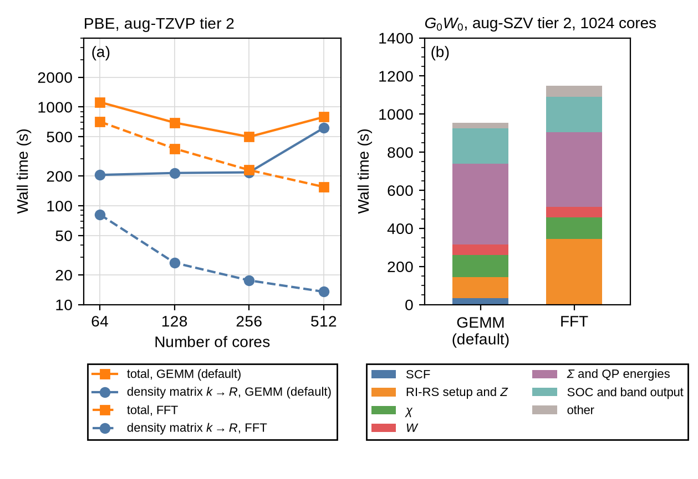

# CP2K CPU benchmarks on Noctua 2: DFT, k-point DFT and low-scaling G₀W₀

Summary report: [cp2k_benchmarks_noctua2.pdf](cp2k_benchmarks_noctua2.pdf).

Wall times of six CP2K test cases on 0.5, 1, 2 and 4 nodes of Noctua 2 (PC2 Paderborn), as CPU reference
for porting to GPUs. Each table entry is the CP2K wall time in seconds and links to the output.
**–** = the run does not fit into the memory of the nodes (killed by the out-of-memory handler or stopped by a
CP2K memory check; the link leads to the output and the Slurm log).

## Timings (s)

| Test | 0.5 node (64 cores) | 1 node (128 cores) | 2 nodes (256 cores) | 4 nodes (512 cores) | 8 nodes (1024 cores) |
|:---|---:|---:|---:|---:|---:|
| [64 H₂O (192 atoms), PBE, TZV2P-MOLOPT-GTH, Γ point](inputs/water_64_PBE_TZV2P/) | [191](outputs/water_64_PBE_TZV2P/0.5n/output.out) | [98](outputs/water_64_PBE_TZV2P/1n/output.out) | [59](outputs/water_64_PBE_TZV2P/2n/output.out) | [37](outputs/water_64_PBE_TZV2P/4n/output.out) |  |
| [TiO₂ anatase (12 atoms), PBE, aug-TZVP-MOLOPT tier 2, 12×12×12 k, RSKP_TRANSFORM FFT](inputs/anatase_DFT_aug-TZ2_FFT/) | [710](outputs/anatase_DFT_aug-TZ2_FFT/0.5n/output.out) | [379](outputs/anatase_DFT_aug-TZ2_FFT/1n/output.out) | [230](outputs/anatase_DFT_aug-TZ2_FFT/2n/output.out) | [155](outputs/anatase_DFT_aug-TZ2_FFT/4n/output.out) |  |
| [TiO₂ anatase (12 atoms), PBE, aug-TZVP-MOLOPT tier 2, 12×12×12 k, RSKP_TRANSFORM GEMM (default)](inputs/anatase_DFT_aug-TZ2/) | [1120](outputs/anatase_DFT_aug-TZ2/0.5n/output.out) | [694](outputs/anatase_DFT_aug-TZ2/1n/output.out) | [498](outputs/anatase_DFT_aug-TZ2/2n/output.out) | [792](outputs/anatase_DFT_aug-TZ2/4n/output.out) |  |
| [TiO₂ anatase (12 atoms), G₀W₀@PBE, aug-SZV-MOLOPT tier 2, 12×12×12 k, GEMM (default)](inputs/anatase_GW_aug-SZ2/) | [–](outputs/anatase_GW_aug-SZ2/0.5n/) | [–](outputs/anatase_GW_aug-SZ2/1n/) | [–](outputs/anatase_GW_aug-SZ2/2n/) | [–](outputs/anatase_GW_aug-SZ2/4n/) | [953](outputs/anatase_GW_aug-SZ2/8n/output.out) |
| [TiO₂ anatase (12 atoms), G₀W₀@PBE, aug-SZV-MOLOPT tier 2, 12×12×12 k, FFT](inputs/anatase_GW_aug-SZ2_FFT/) |  |  |  |  | [1148](outputs/anatase_GW_aug-SZ2_FFT/8n/output.out) |
| [TiO₂ anatase (12 atoms), G₀W₀@PBE, aug-TZVP-MOLOPT tier 2, 12×12×12 k](inputs/anatase_GW_aug-TZ2/) | [–](outputs/anatase_GW_aug-TZ2/0.5n/) | [–](outputs/anatase_GW_aug-TZ2/1n/) | [–](outputs/anatase_GW_aug-TZ2/2n/) | [–](outputs/anatase_GW_aug-TZ2/4n/) |  |
| [nanographene (296 atoms), G₀W₀@PBE, aug-SZV-MOLOPT tier 2](inputs/nanographene_L16_GW_aug-SZ2/) | [2143](outputs/nanographene_L16_GW_aug-SZ2/0.5n/output.out) | [1095](outputs/nanographene_L16_GW_aug-SZ2/1n/output.out) | [632](outputs/nanographene_L16_GW_aug-SZ2/2n/output.out) | [400](outputs/nanographene_L16_GW_aug-SZ2/4n/output.out) |  |
| [nanographene (1016 atoms), G₀W₀@PBE, aug-SZV-MOLOPT tier 2](inputs/nanographene_L56_GW_aug-SZ2/) | [–](outputs/nanographene_L56_GW_aug-SZ2/0.5n/) | [–](outputs/nanographene_L56_GW_aug-SZ2/1n/) | [4609](outputs/nanographene_L56_GW_aug-SZ2/2n/output.out) | [2497](outputs/nanographene_L56_GW_aug-SZ2/4n/output.out) |  |

## Machine, code, run setup

- Noctua 2, partition `normal`: 2× AMD EPYC 7763 per node, 128 cores, 256 GB RAM per node.
  Half node = 64 cores and 120 GB on a shared node.
- CP2K master `300c0a4f78` (27 Nov 2026), GCC 14.3, OpenMPI 5.0.8, OpenBLAS 0.3.30, ScaLAPACK 2.2.2, FFTW 3.3.10,
  libint 2.11.2, libxc 7.1.2, DBCSR 2.10.0, libxsmm 2.1.0, GreenX 2.2, libwignernj 0.8.0 (`scripts/build_master.sh`).
- 16 MPI ranks × 8 OpenMP threads per node (half node: 8 × 8), `OMP_PROC_BIND=close`, `OMP_PLACES=cores`
  (`scripts/run.sbatch`). One Slurm job per entry. No SCF restart in any run.

## Test cases

| Test | Atoms | Basis functions | Notes |
|:---|---:|---:|:---|
| 64 H₂O, PBE | 192 | 2560 | Γ point, OT, cutoff 400 Ry; coordinates of CP2K `benchmarks/QS/H2O-64.inp` |
| TiO₂ anatase, PBE | 12 | 700 | 12×12×12 Monkhorst-Pack (864 k-points after time reversal), cutoff 1800 Ry, all MOs (`ADDED_MOS -1`) |
| TiO₂ anatase, G₀W₀@PBE | 12 | 208 / 700 | SCF of the PBE test plus periodic RI-RS G₀W₀ with SOC and band structure (225 path k-points), all GW parameters at their defaults; input of [CP2K_GW_RIRS_Bandstructures_3D_2D](https://github.com/JWilhelm/CP2K_GW_RIRS_Bandstructures_3D_2D/tree/main/TiO2_anatase) |
| nanographene, G₀W₀@PBE | 296 / 1016 | 3344 / 11584 | molecular RI-RS G₀W₀ (no periodicity), GW part of the inputs of [real_space_rtbse_nanoribbon](https://github.com/RitajTyagi/real_space_rtbse_nanoribbon) (L = 16 and L = 56, N = 18L + 8 atoms); the 1016-atom structure is built from L = 64 by removing 8 periods |

Basis sets: aug-SZV-MOLOPT-GTH-tier-2 and aug-TZVP-MOLOPT-GTH-tier-2 (`BASIS_AUG_MOLOPT_GTH`), TZV2P-MOLOPT-GTH (`BASIS_MOLOPT`).
Nanographene input change against the published one: `N_POINT_PERCENTAGE` no longer exists in CP2K master; the RI-RS grid
uses the default `RS_AO_RATIO` (7 grid points per AO function: 42 per H, 91 per C instead of 27 and 67).

## Memory: which runs do not fit

| Test | Smallest run that completes | Failure on fewer nodes |
|:---|:---|:---|
| anatase G₀W₀, aug-SZV tier 2 | 8 nodes (10.2 GB/rank) | 0.5 and 2 nodes: killed (d_lP, after W); 1 and 4 nodes: CP2K memory check of the time groups (χ, Σ). The same with the CP2K version of the GW benchmark (`ca4cd0ec1f`), so not a regression. |
| anatase G₀W₀, aug-TZVP tier 2 | 8 largemem nodes (1 TB each), 12638 s, earlier run with `ca4cd0ec1f` | 0.5, 1, 2 nodes killed; the 4-node run was stopped because aug-TZ2 needs more memory than aug-SZ2 in every stage |
| nanographene 1016 atoms | 2 nodes | 0.5 node killed in the first SCF step, 1 node killed in χ (16.6 GB/rank) |

## k-point transform backend: `RSKP_TRANSFORM` GEMM (default) or FFT

Since [cp2k/cp2k#6454](https://github.com/cp2k/cp2k/pull/6454) (16 Nov 2026) `&KPOINTS / RSKP_TRANSFORM` selects GEMM (default) or FFT
for the real-space/k-point transforms; the former `LATTICE_FFT AUTO` (FFT from 27 k-points on) was removed.
- **Anatase PBE, aug-TZVP tier 2:** FFT is 1.6–5.1× faster. With GEMM the density-matrix transform k → R does not scale
  (205 s on 0.5 node, 614 s on 4 nodes: one reduction over all ranks per atom-block tile), with FFT it takes 13–80 s.
  Same total energy (to 1E-12 Hartree), same memory.
- **Anatase G₀W₀, aug-SZV tier 2, 8 nodes:** GEMM is faster (953 s against 1148 s); with FFT the R → k transform of the
  basis functions on the RI-RS grid (`build_all_phi_k`) takes 224 s. Same band gap (3.100 eV).
- **Diamond, DZVP-MOLOPT-SR, 8 MPI × 1 OpenMP** (the benchmark of cp2k/cp2k#6454, `kp_transform_diamond/`):

| k mesh | 4×4×4 | 6×6×6 | 8×8×8 | 10×10×10 | 20×20×20 | 30×30×30 |
|:---|---:|---:|---:|---:|---:|---:|
| GEMM (s) | 1.42 | 1.14 | 1.16 | 1.24 | 1.63 | 2.83 |
| FFT (s) | 1.13 | 1.14 | 1.15 | 1.18 | 1.67 | 3.32 |

## Where the time goes

RI-RS G₀W₀ does not use the three-center integrals (μν|P) in χ, W and Σ; libint three-center integrals are computed only for small atom clusters in the RI-RS grid optimization and stay below 2 % of the time. In the molecular
G₀W₀ the RI-RS grid optimization (57 % on 1 node for 296 atoms), W, Σ and the SCF dominate, in the periodic G₀W₀
Σ (with the analytic continuation), χ and the SOC band output.

## Files

- `inputs/<test>/`: CP2K inputs (and `struc.xyz`), `outputs/<test>/<n>n/`: `output.out`, Slurm log, stderr of failed runs.
- `scripts/`: build, job and submission scripts, `collect_timings.py` (→ `timings.json`), `plot_benchmarks.py`, `make_readme_table.py`.
- `kp_transform_diamond/`: inputs and outputs of the diamond transform benchmark.
