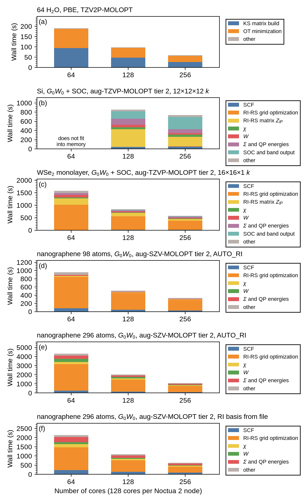

# CP2K CPU benchmarks on Noctua 2: DFT and low-scaling G₀W₀

Wall times of six CP2K test cases on 0.5, 1 and 2 nodes of Noctua 2 (PC2 Paderborn), as CPU reference
for porting to GPUs. Each table entry is the CP2K wall time in seconds and links to the output.
**–** = the run does not fit into the memory of the nodes (the link leads to the output and the Slurm log).

## Timings (s)

| Test | 0.5 node (64 cores) | 1 node (128 cores) | 2 nodes (256 cores) |
|:---|---:|---:|---:|
| [64 H₂O (192 atoms), PBE, TZV2P-MOLOPT-GTH, Γ point](inputs/water_64_PBE_TZV2P/) | [191](outputs/water_64_PBE_TZV2P/0.5n/output.out) | [98](outputs/water_64_PBE_TZV2P/1n/output.out) | [59](outputs/water_64_PBE_TZV2P/2n/output.out) |
| [Si (2 atoms), G₀W₀@PBE + SOC, aug-TZVP-MOLOPT-GTH tier 2, 12×12×12 k](inputs/Si_GW_aug-TZ2/) | [–](outputs/Si_GW_aug-TZ2/0.5n/) | [857](outputs/Si_GW_aug-TZ2/1n/output.out) | [737](outputs/Si_GW_aug-TZ2/2n/output.out) |
| [WSe₂ monolayer (3 atoms), G₀W₀@PBE + SOC, aug-TZVP-MOLOPT-GTH tier 2, 16×16×1 k](inputs/WSe2_monolayer_GW_aug-TZ2/) | [1574](outputs/WSe2_monolayer_GW_aug-TZ2/0.5n/output.out) | [840](outputs/WSe2_monolayer_GW_aug-TZ2/1n/output.out) | [580](outputs/WSe2_monolayer_GW_aug-TZ2/2n/output.out) |
| [nanographene (98 atoms), G₀W₀@PBE, aug-SZV-MOLOPT-GTH tier 2, AUTO_RI](inputs/nanographene_L5_GW_aug-SZ2/) | [958](outputs/nanographene_L5_GW_aug-SZ2/0.5n/output.out) | [512](outputs/nanographene_L5_GW_aug-SZ2/1n/output.out) | [332](outputs/nanographene_L5_GW_aug-SZ2/2n/output.out) |
| [nanographene (296 atoms), G₀W₀@PBE, aug-SZV-MOLOPT-GTH tier 2, AUTO_RI](inputs/nanographene_L16_GW_aug-SZ2_autoRI/) | [4322](outputs/nanographene_L16_GW_aug-SZ2_autoRI/0.5n/output.out) | [2036](outputs/nanographene_L16_GW_aug-SZ2_autoRI/1n/output.out) | [1093](outputs/nanographene_L16_GW_aug-SZ2_autoRI/2n/output.out) |
| [nanographene (296 atoms), G₀W₀@PBE, aug-SZV-MOLOPT-GTH tier 2, RI basis from file](inputs/nanographene_L16_GW_aug-SZ2/) | [2143](outputs/nanographene_L16_GW_aug-SZ2/0.5n/output.out) | [1095](outputs/nanographene_L16_GW_aug-SZ2/1n/output.out) | [632](outputs/nanographene_L16_GW_aug-SZ2/2n/output.out) |

## Machine, code, run setup

- Noctua 2, partition `normal`: 2× AMD EPYC 7763 per node, 128 cores, 256 GB RAM per node.
  Half node = 64 cores and 120 GB on a shared node.
- CP2K master `300c0a4f78` (27 Nov 2026), GCC 14.3, OpenMPI 5.0.8, OpenBLAS 0.3.30, ScaLAPACK 2.2.2, FFTW 3.3.10,
  libint 2.11.2, libxc 7.1.2, DBCSR 2.10.0, libxsmm 2.1.0, GreenX 2.2, libwignernj 0.8.0 (`scripts/build_master.sh`).
- 16 MPI ranks × 8 OpenMP threads per node (half node: 8 × 8), `OMP_PROC_BIND=close`, `OMP_PLACES=cores`
  (`scripts/run.sbatch`). One Slurm job per entry. No SCF restart in any run.
- k-point SCF with `&KPOINTS / RSKP_TRANSFORM FFT` (lattice FFT for the real-space ↔ k-point transforms).

## Test cases

| Test | Atoms | AO basis functions | RI functions | RI-RS grid points | G₀W₀ gap (eV) |
|:---|---:|---:|---:|---:|---:|
| 64 H₂O, PBE, Γ point, OT, cutoff 400 Ry; coordinates of CP2K `benchmarks/QS/H2O-64.inp` | 192 | 2560 | | | |
| Si, periodic G₀W₀@PBE + SOC, 12×12×12 k, band path | 2 | 108 | 304 | 756 | 1.151 (indirect) |
| WSe₂ monolayer, periodic G₀W₀@PBE + SOC, 16×16×1 k, band path, GAPW | 3 | 175 | 525 | 1225 | 1.973 (direct) |
| nanographene, molecular G₀W₀@PBE, AUTO_RI | 98 | 1078 | 3234 | 7546 | 4.013 |
| nanographene, molecular G₀W₀@PBE, AUTO_RI | 296 | 3344 | 10032 | 23408 | 3.312 |
| nanographene, molecular G₀W₀@PBE, RI basis from `BASIS_RI_AUG_MOLOPT_GTH` | 296 | 3344 | 7080 | 23408 | 3.307 |

- Basis sets: TZV2P-MOLOPT-GTH (water), aug-TZVP-MOLOPT-GTH-tier-2 (Si, WSe₂), aug-SZV-MOLOPT-GTH-tier-2 (nanographene),
  file `BASIS_AUG_MOLOPT_GTH`.
- Si and WSe₂: inputs of [CP2K_GW_RIRS_Bandstructures_3D_2D](https://github.com/JWilhelm/CP2K_GW_RIRS_Bandstructures_3D_2D)
  (`Si/aug-TZ2`, `2D_WSe2/aug-TZ2_k16`) with `RSKP_TRANSFORM FFT` added; all GW parameters at their defaults
  (AUTO_RI with RI_AO_RATIO 3, RI-RS grid optimization with RS_AO_RATIO 7, 30 time/frequency points). The band gaps agree
  with that repository.
- Nanographene: GW part of the inputs of [real_space_rtbse_nanoribbon](https://github.com/RitajTyagi/real_space_rtbse_nanoribbon)
  (no real-time BSE). 296 atoms = length L = 16 of that repository; the 98-atom structure is built from it by removing
  11 periods (`inputs/nanographene_L5_GW_aug-SZ2/struc.xyz`). AUTO_RI rows: RI_AO_RATIO 3 and RS_AO_RATIO 7;
  RI-RS grid optimization in all nanographene runs.

## Memory

All runs fit into memory except Si on a half node (120 GB for 8 MPI ranks = 15 GB per rank): the Slurm out-of-memory
handler stops it in χ at 15.7 GB per rank. CP2K takes the available memory from `/proc/meminfo` (the whole node, 256 GB)
and not from the Slurm limit of the job, and therefore assumes 27.7 GB per rank when it splits χ into groups.
A fix in CP2K is in preparation.

## Where the time goes

- In the nanographene and WSe₂ runs the RI-RS grid optimization takes most of the time (414 of 512 s for 98 atoms and
  542 of 840 s for WSe₂ on 1 node); from 1 to 2 nodes it gets 1.5× (WSe₂), 1.6× (98 atoms) and 2.0× (296 atoms) faster.
- Si: the SOC Hamiltonian in the k-points of the band path, the SOC diagonalizations and the analytic continuation of
  Σ do not get faster with more nodes, so Si gets only 1.2× faster from 1 to 2 nodes.
- Three-center integrals (μν|P) with libint are computed only for small atom clusters in the RI-RS grid optimization and,
  for WSe₂, in the analytic d_lP of the RI-RS matrix (130 of 840 s on 1 node); χ, W and Σ do not use them.

## Files

- `inputs/<test>/`: CP2K inputs (and `struc.xyz`), `outputs/<test>/<n>n/`: `output.out`, Slurm log, stderr of failed runs.
- `scripts/`: build, job and submission scripts, `collect_timings.py` (→ `timings.json`), `plot_benchmarks.py`, `make_readme_table.py`.
