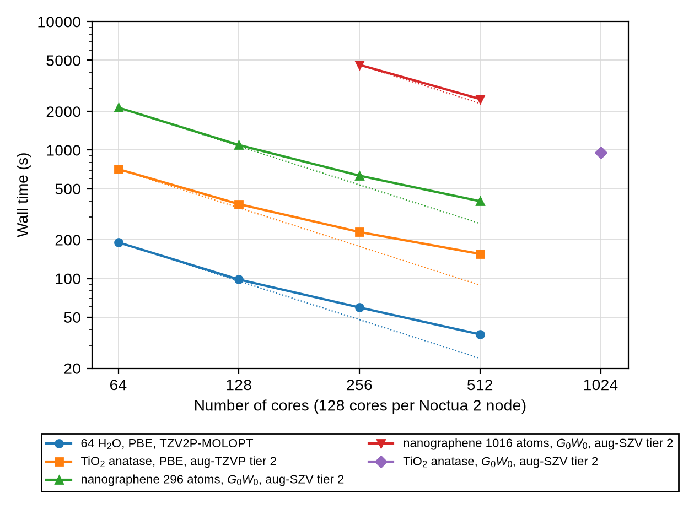

# CP2K CPU benchmarks on Noctua 2: DFT and low-scaling G₀W₀

Summary report: [cp2k_benchmarks_noctua2.pdf](cp2k_benchmarks_noctua2.pdf).

Wall times of six CP2K test cases on 0.5, 1 and 2 nodes of Noctua 2 (PC2 Paderborn), as CPU reference
for porting to GPUs. Each table entry is the CP2K wall time in seconds and links to the output.
**–** = the run does not fit into the memory of the nodes (the link leads to the output and the Slurm log).

## Timings (s)

| Test | 0.5 node (64 cores) | 1 node (128 cores) | 2 nodes (256 cores) |
|:---|---:|---:|---:|
| [64 H₂O (192 atoms), PBE, TZV2P-MOLOPT-GTH, Γ point](inputs/water_64_PBE_TZV2P/) | [191](outputs/water_64_PBE_TZV2P/0.5n/output.out) | [98](outputs/water_64_PBE_TZV2P/1n/output.out) | [59](outputs/water_64_PBE_TZV2P/2n/output.out) |
| [Si (2 atoms), G₀W₀@PBE + SOC, aug-TZVP-MOLOPT-GTH tier 2, 12×12×12 k](inputs/Si_GW_aug-TZ2/) | [–](outputs/Si_GW_aug-TZ2/0.5n/) | [857](outputs/Si_GW_aug-TZ2/1n/output.out) | [737](outputs/Si_GW_aug-TZ2/2n/output.out) |
| [WSe₂ monolayer (3 atoms), G₀W₀@PBE + SOC, aug-TZVP-MOLOPT-GTH tier 2, 16×16×1 k](inputs/WSe2_monolayer_GW_aug-TZ2/) | [1574](outputs/WSe2_monolayer_GW_aug-TZ2/0.5n/output.out) | [840](outputs/WSe2_monolayer_GW_aug-TZ2/1n/output.out) | [580](outputs/WSe2_monolayer_GW_aug-TZ2/2n/output.out) |
| [nanographene (98 atoms), G₀W₀@PBE, aug-SZV-MOLOPT-GTH tier 2, AUTO_RI](inputs/nanographene_L5_GW_aug-SZ2/) | [958](outputs/nanographene_L5_GW_aug-SZ2/0.5n/output.out) | [512](outputs/nanographene_L5_GW_aug-SZ2/1n/output.out) | [332](outputs/nanographene_L5_GW_aug-SZ2/2n/output.out) |
| [nanographene (296 atoms), G₀W₀@PBE, aug-SZV-MOLOPT-GTH tier 2, AUTO_RI](inputs/nanographene_L16_GW_aug-SZ2_autoRI/) | [4322](outputs/nanographene_L16_GW_aug-SZ2_autoRI/0.5n/output.out) | [2036](outputs/nanographene_L16_GW_aug-SZ2_autoRI/1n/output.out) | [1093](outputs/nanographene_L16_GW_aug-SZ2_autoRI/2n/output.out) |
| [nanographene (296 atoms), G₀W₀@PBE, aug-SZV-MOLOPT-GTH tier 2, RI basis from file](inputs/nanographene_L16_GW_aug-SZ2/) | [2143](outputs/nanographene_L16_GW_aug-SZ2/0.5n/output.out) | [1095](outputs/nanographene_L16_GW_aug-SZ2/1n/output.out) | [632](outputs/nanographene_L16_GW_aug-SZ2/2n/output.out) |

Wall time against the number of cores; dotted lines: ideal scaling from the smallest run.

## Machine, code, run setup

- Noctua 2, partition `normal`: 2× AMD EPYC 7763 per node, 128 cores, 256 GB RAM per node.
  Half node = 64 cores and 120 GB on a shared node.
- CP2K master `300c0a4f78` (27 Nov 2026), GCC 14.3, OpenMPI 5.0.8, OpenBLAS 0.3.30, ScaLAPACK 2.2.2, FFTW 3.3.10,
  libint 2.11.2, libxc 7.1.2, DBCSR 2.10.0, libxsmm 2.1.0, GreenX 2.2, libwignernj 0.8.0 (`scripts/build_master.sh`).
- 16 MPI ranks × 8 OpenMP threads per node (half node: 8 × 8), `OMP_PROC_BIND=close`, `OMP_PLACES=cores`
  (`scripts/run.sbatch`). One Slurm job per entry. No SCF restart in any run.
- k-point SCF with `&KPOINTS / RSKP_TRANSFORM FFT` (lattice FFT for the real-space ↔ k-point transforms).

